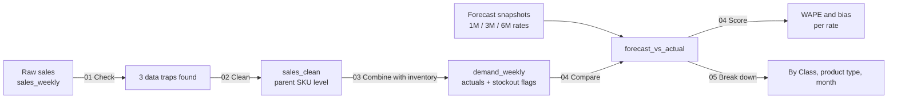

# Which forecast rate should a planner trust?

Forecast accuracy analysis in SQL for a weekly demand planning routine.

Every Monday a demand planner looks at three forecast rates per SKU: the average expected weekly sales over the next 1 month, 3 months and 6 months. They often disagree, and the choice matters. Calculate days of inventory with the wrong rate and you either run out of stock or tie up cash in overstock.

This project measures which rate actually predicts demand best, for which decision, and where the forecast goes wrong.

> The answer in one line: use the 1-month rate for decisions about the next 4 weeks and the 3-month rate for supplier orders. Always remove stockout weeks before judging the forecast: otherwise a good forecast looks 5–6% too high.

Skills shown: data quality checks, joins, window functions (`LAG`), CTEs (`WITH`), views, conditional aggregation, and forecast accuracy measurement (WAPE, bias) designed around real planning decisions.

## The data

A simulated dataset of a fictional Dutch e-commerce company, *Kanaal Electric B.V.*, selling electrical installation components. No real company data is used.

- 498 parent SKUs (659 sellable SKUs including Amazon bundles) in 4 categories: sockets, switches and outlets, wires and cables, circuit protection
- Two channels: Amazon (~60% of revenue, shipped from Amazon FBA) and B2B (~40%, shipped from the company warehouse in the Netherlands)
- Suppliers in China, Vietnam and Morocco; imports through the Port of Rotterdam
- 203 weeks of history (January 2023 – November 2026), planned weekly
- Realistic conditions built in: Dutch seasonality (spring renovation peak, *bouwvak* construction holiday), Amazon Prime Day and Black Friday, Red Sea shipping delays, three material price increases in 2026, stockouts, new launches and discontinued products

Full table descriptions: [`data/DATA_DICTIONARY.md`](data/DATA_DICTIONARY.md)

## How to run it

1. Load the CSV files in [`data/`](data) into a SQLite database, one table per file, named after the file (e.g. `sales_weekly.csv` → `sales_weekly`). Any SQL tool works; I used DataGrip.
2. Run the files in [`sql/`](sql) in order, `01` to `05`. Files 02–04 create three views: `sales_clean`, `demand_weekly` and `forecast_vs_actual`.

## Approach

| Step | File | What it does |
|---|---|---|
| 1 | [`01_data_quality_checks.sql`](sql/01_data_quality_checks.sql) | Finds three problems in the raw sales export: an old channel code, a missing week, and a week loaded twice |
| 2 | [`02_sales_clean.sql`](sql/02_sales_clean.sql) | Fixes them, converts Amazon bundles into parent units, and separates returns from sales |
| 3 | [`03_demand_weekly.sql`](sql/03_demand_weekly.sql) | Fills the missing week from the inventory records and flags every stockout week |
| 4 | [`04_forecast_accuracy.sql`](sql/04_forecast_accuracy.sql) | Puts each forecast next to what actually sold afterwards and scores the three rates |
| 5 | [`05_accuracy_breakdown.sql`](sql/05_accuracy_breakdown.sql) | Breaks accuracy down by Class, product type and month to find where the forecast is weakest |

## How accuracy is measured

- WAPE (Weighted Absolute Percentage Error) = *how big* the errors are. All errors are added up ignoring plus or minus, then divided by total actual sales. Lower is better. Big-selling SKUs count more than slow movers, so a few tiny SKUs can't distort the result.
- Bias = *which direction* the errors lean. Same calculation, but plus and minus are kept. Negative = forecast too low (stockout risk); positive = forecast too high (overstock risk). Within ±5% is treated as acceptable.
- Only forecasts from 2024 onward are scored (the tool needed 2023 to learn the seasonal pattern), and only complete windows.
- Stockout weeks are excluded. When a product is out of stock for 2 or more days in a week, sales understate what customers wanted, so the forecast can't be fairly judged on that week.

## Finding 1: The best rate depends on the decision

| Decision | Horizon | WAPE 1M | WAPE 3M | WAPE 6M | Winner |
|---|---|---|---|---|---|
| Short-term moves (FBA transfers, expediting) | Next 4 weeks | 21.3% | 23.5% | 23.8% | 1M rate |
| Supplier orders (~13-week lead time) | Next 13 weeks | 20.4% | 18.2% | 19.6% | 3M rate |

The 1M rate reacts fastest to the season, so it wins in the short term. The 3M rate is steadier and wins over the lead time of a supplier order. The 6M rate never wins; it's best treated as background context. Bias is close to zero for all three rates (between −1.9% and +0.5%).

## Finding 2: Stockouts make a good forecast look bad

| Bias (next 13 weeks) | 1M | 3M | 6M |
|---|---|---|---|
| Stockout weeks excluded | −1.3% | +0.3% | +0.5% |
| Stockout weeks included | +4.9% | +5.7% | +5.6% |

Measured the usual way, against raw sales, the forecast looks 5–6% too high. It isn't: sales were capped by empty shelves. A planner who cuts the forecast on that basis orders less, causes more stockouts, sees even lower sales, and cuts again. Stockout weeks must be removed before judging or adjusting a forecast.

## Finding 3: The worst forecasts are in low-margin, new, outdoor and price-hit products

By Class (1 = highest margin):

| Class | WAPE 3M | Bias 3M |
|---|---|---|
| 1 | 16.6% | −0.1% |
| 2 | 19.0% | −2.0% |
| 3 | 18.2% | −1.7% |
| 4 | 17.9% | +3.8% |
| 5 | 24.1% | +9.5% |

Class 5 is consistently over-forecast, so stock builds up in the products that earn the least.

By product type, three clear patterns:

| Pattern | Product types | Bias 3M | Likely cause |
|---|---|---|---|
| New products, under-forecast | SmartSwitch, SmartPlug, SurgeProtector | −49%, −19%, −11% | Little history and fast growth: the forecast trails demand |
| Outdoor products, over-forecast | ExtensionReel, ExtensionCable | +26%, +23% | One seasonal pattern per category doesn't fit outdoor items |
| Copper cable, over-forecast | Cable | +12% | 2026 price increases cut demand; the tool doesn't see prices |

When WAPE and the size of the bias are close (ExtensionReel: 29.0% vs +26.3%), nearly every error points the same way. That's a systematic, fixable error rather than random noise.

By month the forecast was made: November is under-forecast (−8.3%, Black Friday), July over-forecast (+7.5%, the Prime Day spike right before the *bouwvak* holiday), and December over-forecast (+6.2%, quiet Christmas weeks). The tool handles gradual seasonality, but not short, sharp calendar events.

## What a planner should do with this

1. Use the 3M rate for supplier orders and the 1M rate for 4-week decisions such as FBA transfers.
2. Exclude stockout weeks from any accuracy report before acting on it.
3. Review Class 5 forecasts before ordering; they run about 10% high.
4. Don't trust the tool for new products in their first months; use a launch plan or a similar product's history.
5. Plan promotions and holidays in manually (Prime Day, Black Friday, *bouwvak*, Christmas), and give outdoor products their own seasonal pattern.

The next project, forecast modelling in Python, tests these fixes and measures how much they improve accuracy.
